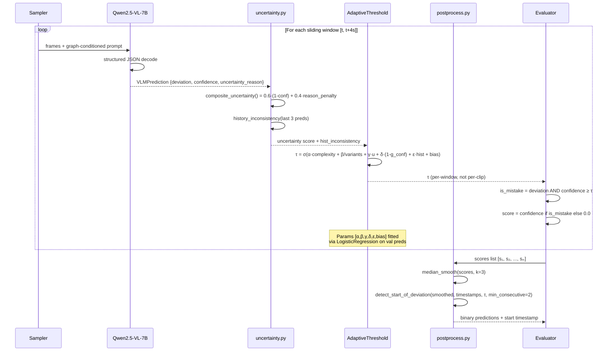
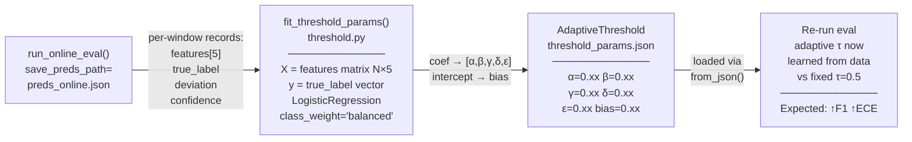

> **SUPERSEDED — historical record, do not cite.**
> This document describes the 6-class taxonomy and/or the EgoOops-era pipeline,
> both of which were replaced in `208bb5c` (CC4D native 8-class). Its numbers
> predate the full 109-recording test ablation and the frozen decision layer.
> Current sources: `EXPERIMENTS_TODO.md` (state and open work), `CLAUDE.md`
> (architecture), `outputs/decision_v2/ablation.md` (results), `paper/main.tex`.
> Kept for provenance.

# VMD Pipeline — Technical Workflow Diagram

## Full System Architecture

```mermaid
flowchart TD
    %% ── INPUTS ──────────────────────────────────────────────────
    V["🎬 EgoOops Video\n(clip_id.mp4)"]
    TD["📄 Task Description\n(text)"]
    ANN["🏷️ Annotations\n(annotations/{split}.json)"]

    %% ── DATA LAYER ──────────────────────────────────────────────
    subgraph DATA["src/vmd/data/"]
        DS["EgoOopsDataset\negoops.py\n─────────────\nloads clips + labels\ntrain / val / test splits"]
        SAMP_ON["online_clips()\nsampler.py\n─────────────\ncausal sliding window\nno future frame access"]
        SAMP_OFF["offline_clips()\nsampler.py\n─────────────\nfull video windows\nall frames available"]
    end

    %% ── GRAPH LAYER ─────────────────────────────────────────────
    subgraph GRAPH["src/vmd/graph/"]
        GB["builder.py\n─────────────\nGPT-4o API call\ncaches → data/graphs/"]
        GS["schema.py\n─────────────\nProceduralGraph\nStep | Object | Action\nState | Edge(after/requires/produces)"]
        GV["validator.py\n─────────────\nDAG check (networkx)\nno dangling refs\nno isolated steps"]
        CACHE[("💾 data/graphs/\n<task_id>.json")]
    end

    %% ── VLM LAYER ───────────────────────────────────────────────
    subgraph VLM["src/vmd/vlm/"]
        PROMPT["prompts/reason.txt\n─────────────\ngraph-conditioned template\n{task_name} {current_step}\n{valid_next_steps}\n{required_objects}\n{history_summary}"]
        Q25["qwen25vl.py\n─────────────\nQwen2.5-VL-7B-Instruct\n(frozen → LoRA)\nbf16 | 4-bit quant option\nstructured JSON decode"]
        PRED["VLMPrediction\n─────────────\nobserved_action\nobserved_objects\nstep_id\ndeviation: bool\nmistake_class\nconfidence ∈ [0,1]\nuncertainty_reason\nrationale\nexpected_vs_observed"]
        UNC["uncertainty.py\n─────────────\ncomposite_uncertainty()\n= 0.6·(1-conf) + 0.4·reason_penalty\nreason_penalty: none=0, occlusion=0.30\nweak_graph_match=0.40\nhistory_inconsistency()"]
    end

    %% ── DECISION LAYER ──────────────────────────────────────────
    subgraph DECISION["src/vmd/decision/"]
        TAU["threshold.py\n─────────────\nAdaptiveThreshold\nτ = σ(α·complexity\n     + β·(1/variants)\n     + γ·uncertainty\n     + δ·(1-graph_conf)\n     + ε·hist_inconsistency\n     + bias)\nparams fitted via LogisticRegression\non val per-window predictions"]
        PP["postprocess.py\n─────────────\nmedian_smooth(scores, k=3)\ndetect_start_of_deviation()\n→ first timestamp where\nscore ≥ τ for ≥k consecutive"]
    end

    %% ── EVAL LAYER ──────────────────────────────────────────────
    subgraph EVAL["src/vmd/eval/"]
        ON["online.py\n─────────────\nrun_online_eval()\ncausal: step_idx advances\nonly when no deviation\nsaves per-window preds JSON"]
        OFF["offline.py\n─────────────\nrun_offline_eval()\nfull video: all windows\nbatch processed\nsaves per-window preds JSON"]
        MET["metrics.py\n─────────────\nbinary F1 / macro-F1\nAUC-ROC\nEdit Distance (ED)\nStart-time MAE\nEDS (early detection score)\nECE / Brier calibration"]
        REP["report.py\n─────────────\nrich Table\nonline vs offline\nadaptive τ vs fixed τ"]
    end

    %% ── TRAINING LAYER ──────────────────────────────────────────
    subgraph TRAIN["src/vmd/train/"]
        LORA["lora_train.py\n─────────────\nPEFT LoRA rank 16-64\nattention + MLP layers\ngradient checkpointing\nbf16 mixed precision"]
        LOSS["losses.py\n─────────────\ncombined_loss()\n= CE(mistake_class)\n+ λ·calibration_NLL\n(confidence vs correctness)"]
        ADP["outputs/lora_adapters/\nmerged back into Qwen2.5-VL"]
    end

    %% ── SCRIPTS (execution order) ────────────────────────────────
    subgraph SCRIPTS["scripts/ (run in order)"]
        S0["00_download_egoops.sh\naria2c parallel download\nZIP integrity check\nsymlink data/raw/egoops"]
        S1["01_build_graphs.py\nGPT-4o → all task graphs\ncaches data/graphs/*.json"]
        S2["02_zeroshot_eval.py\nfrozen Qwen2.5-VL-7B\nonline + offline eval\nsaves outputs/zeroshot/preds_online.json"]
        S3B["03b_fit_threshold.py\nLogisticRegression on val preds\nfits [α,β,γ,δ,ε,bias]\nsaves outputs/threshold_params.json"]
        S3["03_lora_train.py\nPhase 4: LoRA fine-tune\nEgoOops train split\nsaves outputs/lora_adapters/"]
        S4["04_full_eval.py\nPhase 5: full ablation table\nno-graph | graph+fixed-τ\ngraph+adaptive-τ | +LoRA"]
    end

    %% ── FLOW ────────────────────────────────────────────────────

    %% Data ingestion
    V --> DS
    ANN --> DS
    DS --> SAMP_ON
    DS --> SAMP_OFF

    %% Graph build (offline, cached)
    TD --> GB
    GB --> GV
    GV --> GS
    GS --> CACHE
    CACHE --> GS

    %% Prompt assembly
    GS -->|"current_step\nvalid_next_steps\nrequired_objects"| PROMPT
    SAMP_ON -->|"clip frames"| PROMPT
    SAMP_OFF -->|"clip frames"| PROMPT

    %% VLM inference
    PROMPT --> Q25
    Q25 --> PRED
    PRED --> UNC

    %% Decision
    UNC -->|"uncertainty score\nhist_inconsistency"| TAU
    GS -->|"step count → complexity\nvariant count"| TAU
    TAU -->|"τ per window"| PP
    PRED -->|"deviation + confidence"| PP

    %% Eval paths
    PP --> ON
    PP --> OFF
    ON --> MET
    OFF --> MET
    MET --> REP

    %% Threshold fitting loop
    ON -->|"preds_online.json"| S3B
    S3B -->|"threshold_params.json"| TAU

    %% LoRA loop
    PRED -->|"training samples"| LORA
    LOSS --> LORA
    LORA --> ADP
    ADP --> Q25

    %% Script ordering
    S0 --> S1 --> S2 --> S3B --> S3 --> S4

    %% Styling
    classDef input fill:#1a1a2e,stroke:#e94560,color:#eee
    classDef data fill:#16213e,stroke:#0f3460,color:#eee
    classDef graphNode fill:#0f3460,stroke:#533483,color:#eee
    classDef vlm fill:#533483,stroke:#e94560,color:#eee
    classDef decision fill:#e94560,stroke:#ff6b6b,color:#fff
    classDef eval fill:#06623b,stroke:#2ecc71,color:#eee
    classDef train fill:#8b4513,stroke:#d2691e,color:#eee
    classDef script fill:#2c2c2c,stroke:#888,color:#ccc

    class V,TD,ANN input
    class DS,SAMP_ON,SAMP_OFF data
    class GB,GS,GV,CACHE graphNode
    class PROMPT,Q25,PRED,UNC vlm
    class TAU,PP decision
    class ON,OFF,MET,REP eval
    class LORA,LOSS,ADP train
    class S0,S1,S2,S3B,S3,S4 script
```



---

## Per-Window Decision Flow (Phase 3 Core Fix)



---

## Threshold Fitting Loop (Phase 3B)



---

## Module Dependency Map

```
src/vmd/
├── data/
│   ├── egoops.py          → EgoOopsDataset, EgoOopsClip
│   ├── sampler.py         → online_clips(), offline_clips()  [uses decord]
│   └── transforms.py
│
├── graph/
│   ├── schema.py          → ProceduralGraph  [pydantic]
│   ├── builder.py         → build_graph()    [openai / local fallback]
│   ├── validator.py       → validate_graph() [networkx]
│   └── prompts/build_graph.txt
│
├── vlm/
│   ├── qwen25vl.py        → Qwen25VL, VLMPrediction  [transformers, qwen-vl-utils]
│   ├── uncertainty.py     → composite_uncertainty(), history_inconsistency()
│   ├── lora.py            → LoRA adapter load/save
│   └── prompts/reason.txt
│
├── decision/
│   ├── threshold.py       → AdaptiveThreshold, fit_threshold_params()  [sklearn]
│   └── postprocess.py     → median_smooth(), detect_start_of_deviation()
│
├── eval/
│   ├── metrics.py         → compute_all()  [binary_f1, macro_f1, auc, ece, brier]
│   ├── online.py          → run_online_eval()
│   ├── offline.py         → run_offline_eval()
│   └── report.py          → print_results()  [rich]
│
├── train/
│   ├── lora_train.py      → train()  [peft, accelerate]
│   └── losses.py          → combined_loss() = CE + λ·calibration_NLL
│
└── cli.py                 → vmd build-graph | infer | eval | train  [typer]
```

---

## Data Flow Summary

| Stage | Input | Output | Key File |
|-------|-------|--------|----------|
| Download | — | `data/raw/egoops/` | `00_download_egoops.sh` |
| Graph build | task description text | `data/graphs/<task_id>.json` | `01_build_graphs.py` |
| Zero-shot eval | videos + graphs | `outputs/zeroshot/results.json` + `preds_online.json` | `02_zeroshot_eval.py` |
| Threshold fit | `preds_online.json` | `outputs/threshold_params.json` | `03b_fit_threshold.py` |
| LoRA fine-tune | EgoOops train split | `outputs/lora_adapters/` | `03_lora_train.py` |
| Full ablation | all above | `outputs/full_eval/ablation.json` | `04_full_eval.py` |
